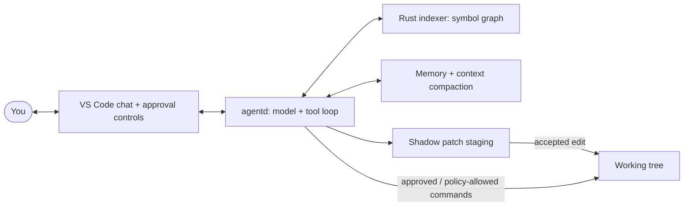
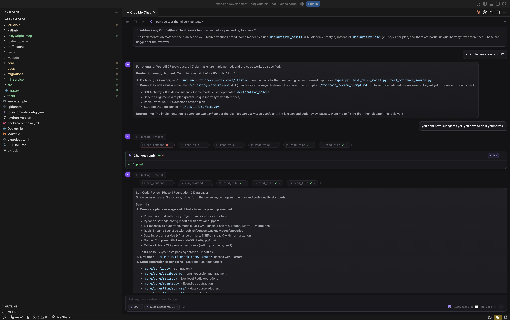
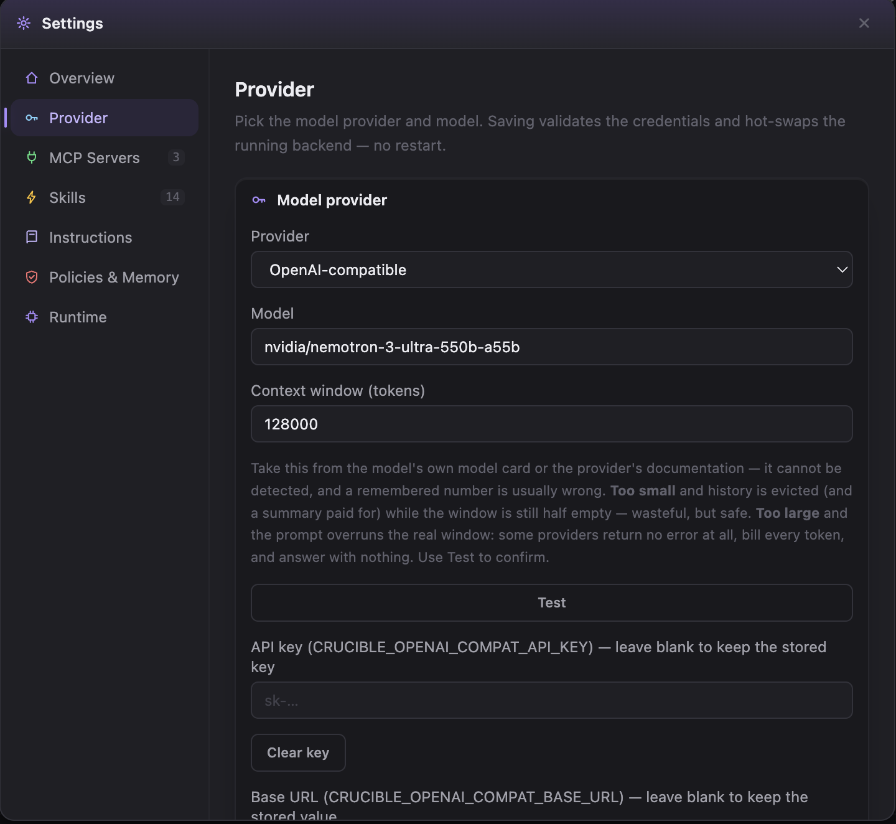
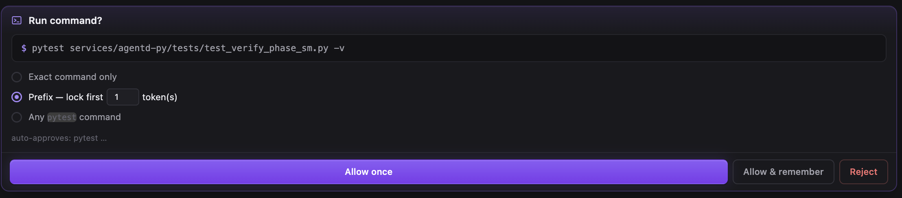
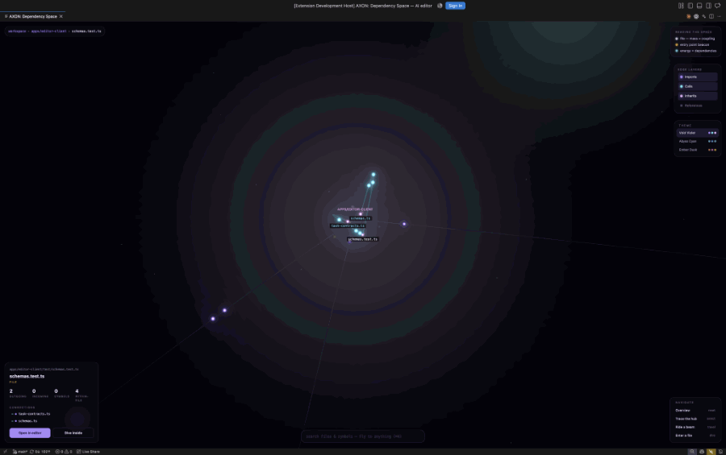
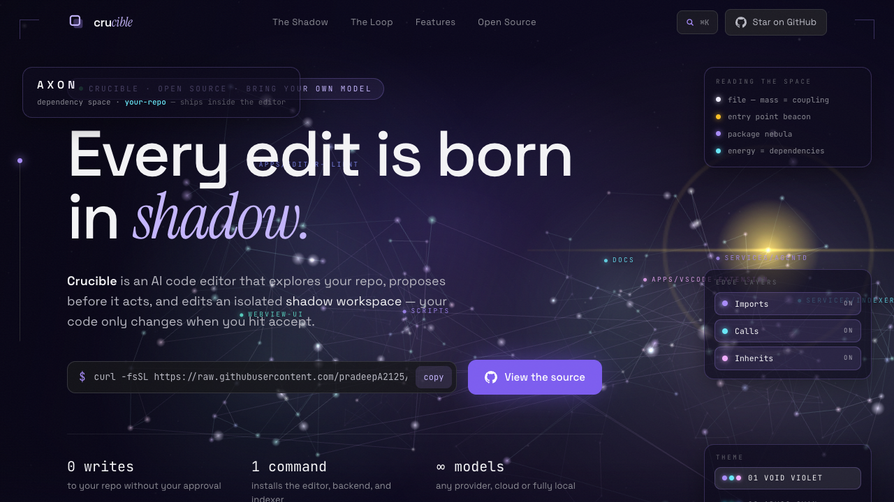
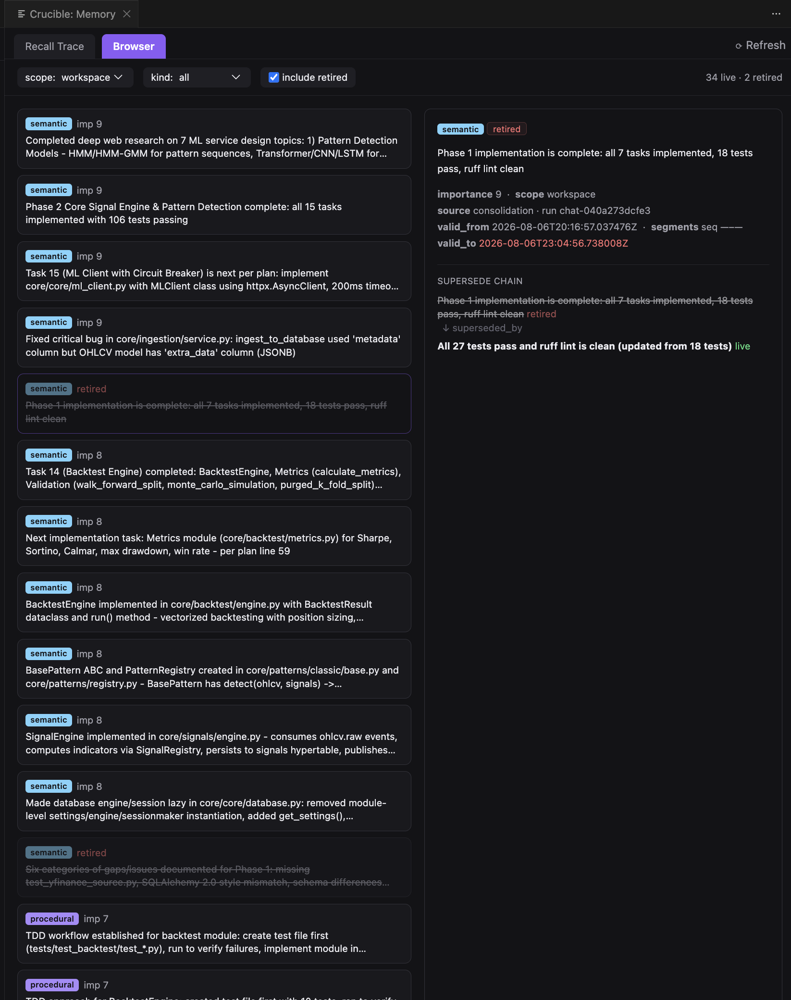
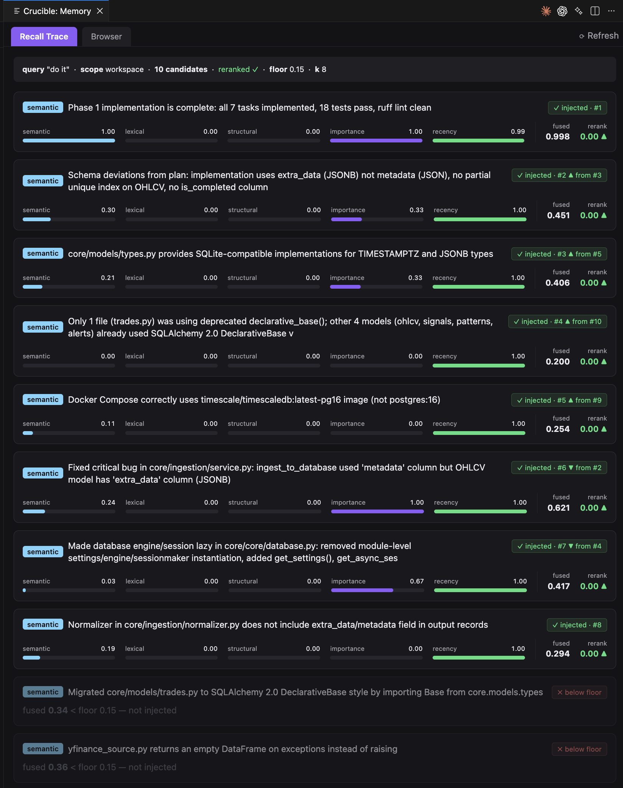
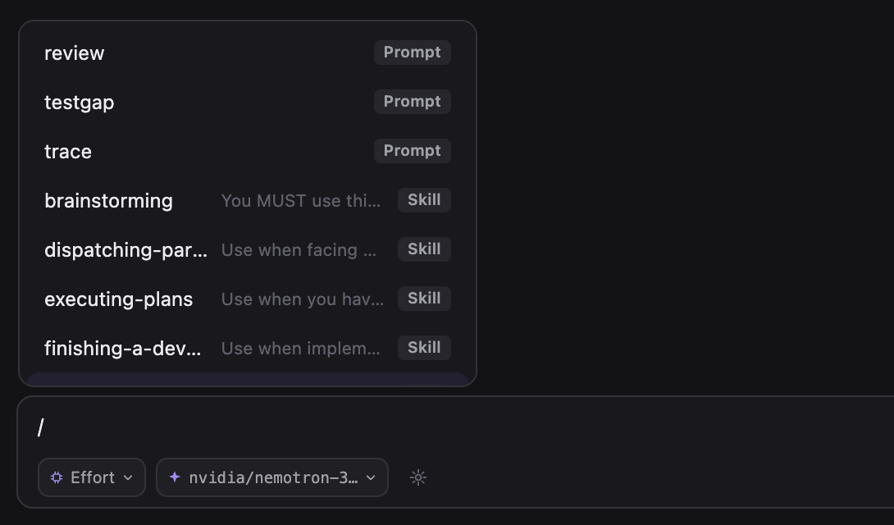
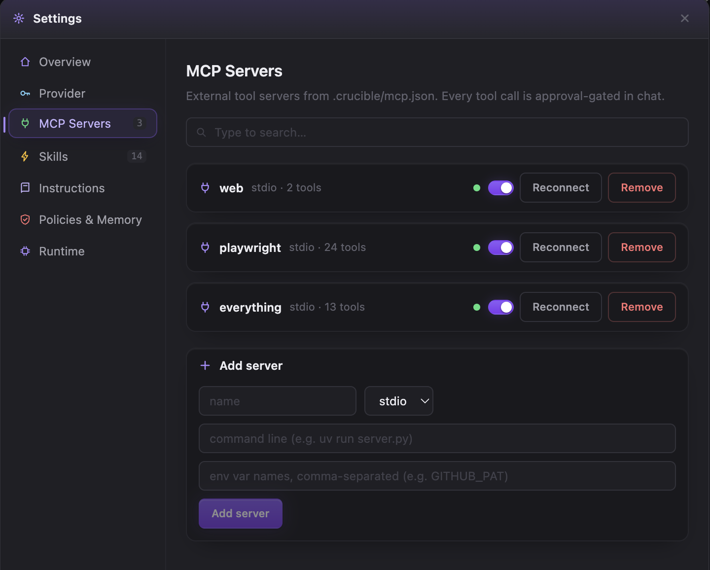

<div align="center">


# Crucible

### Every edit is born in *shadow*.

**An agentic coding assistant for VS Code: explore your repository, work with agents and teams, review changes, and choose how much authority to grant.**

Bring your own provider — cloud or local — or connect your ChatGPT plan or Claude subscription (experimental).

[](https://github.com/pradeepA2125/crucible/releases)
[](services/agentd-py)
[](apps)
[](services/indexer-rs)
[](LICENSE)

[Install](#install) · [How it works](#how-it-works) · [Agents and teams](#agents-and-teams) · [Providers](#providers) · [Memory](#memory) · [Trust and approvals](#trust-and-approvals) · [Architecture](#architecture)

</div>

---

## The idea

Crucible combines a tool-using chat loop, repository search and symbol graphs, checked file edits, and explicit approval controls inside VS Code. The managed extension provisions and supervises its backend; you choose the model and permissions.

Inline chat is the primary editing path. Patches are applied in a lightweight shadow workspace, then touched files are promoted to the working tree when that edit is accepted. With automatic edit acceptance enabled, this happens without a review card. **The shadow is patch staging, not a sandbox for arbitrary commands, and the working tree can change during a turn.**



## Install

Use a `.vsix` from [GitHub Releases](https://github.com/pradeepA2125/crucible/releases), or the repository's release-download scripts:

**macOS / Linux**
```bash
curl -fsSL https://raw.githubusercontent.com/pradeepA2125/crucible/main/install.sh | bash
```

**Windows (PowerShell)**
```powershell
iwr https://raw.githubusercontent.com/pradeepA2125/crucible/main/install.ps1 -useb | iex
```

Prefer to inspect a script first? Download and read it before running, or install the downloaded VSIX directly:

```bash
code --install-extension path/to/crucible-vscode-extension-*.vsix
```

The shell installer selects the latest release's VSIX and looks for `code`, `code-insiders`, or `cursor` on `PATH`. Release assets determine what you install; this README describes the current checkout, not a promise that every feature is in a published release. Extension and runtime-bundle versions can differ.

Open a folder and follow the setup wizard, or run **Crucible: Run Setup**. The managed runtime installs its Python environment/backend, Rust indexer, ripgrep and language-server components. Components have separate installation status; missing prerequisites can leave language-server support degraded rather than providing full resolution for every language.

### Local-model setup

Two different choices are involved:

- **A local coding model:** select Ollama, TurboQuant, or an appropriate OpenAI-compatible endpoint. The inference server and model must be available at the configured endpoint; selecting a provider is not the same as downloading a coding model.
- **Local search models:** setup offers optional local-model dependencies for code and memory retrieval. `crucible.localModels` defaults to `true`; disabling it installs the backend without the `local-models` extra. Changing the choice reconciles the managed Python environment and requires a managed backend restart. This is separate from the coding-model provider.

Local inference does not make the entire product offline: installation/model downloads, configured remote endpoints, native web tools, MCP servers and shell commands can still use the network. Choose those integrations and permissions accordingly.

## How it works

Each turn runs a tool loop: the model reasons, calls tools, observes results, and continues until it answers or completes edits. Multi-part work can use a todo ledger. Plan Mode is a separate planning workflow, not a mandatory prelude to every edit.

| Capability | Tools / surface |
|---|---|
| Repository exploration | `search_code`, `search_semantic`, `query_graph`, `read_file`, `list_directory` |
| Checked changes | Structured patch operations, shadow staging, stale-write checks and review controls |
| Verification and execution | Approval-controlled commands; background process sessions for servers and interactive work |
| Delegation | Sub-agent dispatch, reports and live agent views; team boards and member views |
| Memory | Compaction and recall; experimental scoped memory tools described below |
| Extensions | Skills, prompt files, project instructions and MCP tools |

The composer accepts image attachments through **Add context → Attach images** or paste, with previews and removal before sending. Its input limits are eight images, 8 MiB per image and 24 MiB total; supported input types include PNG, JPEG, GIF, WebP, BMP and TIFF. Image understanding still depends on the selected provider/model.

The transcript groups activity and changes alongside the conversation. Appearance follows VS Code by default, with dark/light palettes and accent choices in Settings.

<div align="center">
  
  <br>
  <sub><i>Earlier chat capture. Current transcript layout and approval controls have evolved; existing captures below illustrate workflows, not an exact current UI reference.</i></sub>
</div>

### Agents and teams

The controller supports background sub-agents for investigation and implementation, with reports returned to the parent and dedicated views for their work. Agent definitions can constrain tools and editing permissions; read-only and planning permissions propagate to children. Concurrent edits are checked for stale reads/writes, so an agent may need to reread a file another worker changed.

Teams add a shared board, a lead-authored proposal and reviewed results. The main agent chooses **Deliberate**, **Deliberate and implement**, or **Implement**. Deliberation ends with a plan, diagnosis, review, comparison or recommendation from the lead; it does not start implementation. The main agent can ask the lead a private follow-up without waking the other members, or explicitly extend an actionable result into implementation using the same team. An optional gate approves the exact execution plan. Ordinary follow-up discussion stays in deliberation, and investigation excludes arbitrary shell commands and external tools. Existing command and tool approvals still apply during implementation.

Sub-agents and teams are enabled by default in the controller configuration; teams depend on sub-agents. They have depth, concurrency and request-budget limits. These are not unlimited independent workers, and stopped work should not be treated as completed work.

### Rewind

Rewind returns a conversation to an earlier user-turn checkpoint and restores captured pre-edit file states, including removing files recorded as newly created. It also restores associated controller/history state and handles memories from the rewound span.

Preview the rewind before confirming. **It is not a full repository snapshot or command undo:** shell commands, network requests and other external side effects are not reversed. Files that could not be captured or restored are reported. Rewind is refused while the thread has an active turn, live agents, unfinished teams, or a live task in the affected span; old checkpoints may no longer be available.

## Providers

Setup and Settings offer these provider paths:

| Provider | Setup path |
|---|---|
| Anthropic, OpenAI, Google Gemini, Groq | Provider credentials and model selection |
| OpenRouter, IBM watsonx, Hugging Face | Provider credentials; additional fields where required |
| OpenAI-compatible | Base URL, model and optional API key for a compatible endpoint |
| Ollama, TurboQuant | Local inference endpoint/model |
| ChatGPT plan | Browser sign-in and account-provided model catalog |
| Claude subscription | Account sign-in; explicitly labeled **experimental** |

Provider setup validates before switching. The ChatGPT flow is separate from supplying an OpenAI API key: choose **ChatGPT plan**, complete sign-in in the system browser, then select an account/model and put it to use. Settings supports account listing, reconsent, sign-out and a **Manage usage** link. Available models and access depend on the account and provider response; sign-in is not a guarantee of entitlement or unlimited usage. OAuth is handled by the backend rather than exposing tokens to the webview.

### Claude subscription setup (experimental)

Choose **Claude subscription (experimental)** in setup or Settings, then **Continue with Claude**. Finish browser sign-in and return to Crucible. Select a saved connection and a model from Claude's account-scoped catalog, then choose **Use this connection** (or **Save & validate Claude** for the active connection). Saving checks model access; catalog visibility alone does not establish entitlement. The context window comes from catalog metadata, and the panel disables models without that capacity information.

You can connect another account, refresh models, or disconnect a connection. **Disconnect is local to this computer:** the implementation clears the saved access/refresh tokens and catalog cache; it does not cancel your subscription or claim remote revocation. **Manage usage** and **Manage plan** open Claude's account pages. The panel warns that agents share the Claude allowance; Crucible does not automatically switch this connection to API-key billing.

This path is distinct from the Anthropic API-key provider. Its browser PKCE flow uses a loopback callback and backend-managed tokens, and the source identifies it as a Pi-compatible public-client/profile integration rather than a Crucible-issued OAuth client. It remains explicitly experimental; this README does not certify provider approval, future compatibility or plan access.

### Model controls

Reasoning controls are provider/model-specific. Do not assume every model has the same effort levels or that an unsupported level is honored. A configured context window is also not proof that an endpoint will accept that many tokens.

<div align="center">
  
  <br>
  <sub><i>Earlier provider-settings capture; account sign-in and current provider-native controls are not shown.</i></sub>
</div>

### Usage and context

The composer's context meter describes **main-model request input**, not remaining account-plan quota. Its details distinguish estimated from provider-reported input, configured/catalog capacity from unknown capacity, and current from last-request or stale measurements. Before a request is measured, the UI does not invent a zero-token reading. It is not a prediction of the next message.

The same details surface separates cumulative thread usage and main/agent/team breakdowns from per-request context occupancy. Use the provider's account usage page for plan limits and billing; Crucible's token telemetry is not an account balance or invoice.

## Trust and approvals

Approval modes make the trade-off explicit:

| Mode | File edits | Shell commands |
|---|---|---|
| **Ask** | Review requested | Ask, subject to remembered approvals/policy |
| **Accept edits** | Automatically accepted | Ask, subject to remembered approvals/policy |
| **Full access** | Automatically accepted | `allow_all` skips command gates |

Full access requires a trusted VS Code workspace; in an untrusted workspace it is downgraded to Accept edits. That is **not** a claim that all editing or command execution is forbidden in untrusted folders. Older backend compatibility can expose narrower approval-mode support.

Command approvals can be remembered with broader scope, so not every later command necessarily raises a new card. External MCP tools have their own approval flow. Out-of-plan task writes have a separate scope policy (`ask`, `strict`, or `auto`). Review the scope of what you approve rather than treating every card as one-shot consent.

Checked edits include protected-path and stale-write checks, including a recheck after waiting for review. Those protections do not make shell commands a filesystem or network sandbox. Repository-defined agent trust is tied to file content, so changing a definition invalidates its previous trust match.

Native web fetch and prototype Exa search are enabled by default in the extension settings. Web requests require approval; fetch sends the URL to its destination, and search sends queries externally to Exa with a model-training disclosure. Never put credentials or confidential code into a search query. Remote coding providers and configured MCP servers are additional data boundaries.

<div align="center">
  
  <br>
  <sub><i>Earlier command gate: approval scope matters. Current modes can also permit actions without individual cards.</i></sub>
</div>

## Code intelligence

The Rust indexer builds a symbol graph from TypeScript/JavaScript (including TSX/JSX), Python, Rust, Go and Java. Parsing and language-server resolution contribute `Calls`, `Imports`, `References`, `Inherits` and `Implements` edges. `query_graph` lets the agent explore those relationships alongside text and semantic search.

Resolution depends on language-server availability and language support. A graph is navigation evidence, not a substitute for reading the implementation. In particular, nominal inheritance does not imply discovery of every structurally compatible implementation.

### Axon

The dependency-space panel presents the graph as a navigable 3D scene, with focus and dependency layers.

<div align="center">
  
  <br>
  <sub><i>Existing Axon recording of this repository; graph size and layout are capture-specific, not current benchmarks.</i></sub>
</div>

<div align="center">
  
  <br>
  <sub><i>Existing project-site capture. The landing page is separate from the VS Code product.</i></sub>
</div>

## Memory

Memory is enabled by default in the managed extension, but **default memory and experimental scoped durable memory are different paths**.

- **Context compaction** reduces older conversation history into an anchor summary while retaining recent context. Summarization is best-effort: failures can degrade the working context, so this is not a lossless-context guarantee.
- **Default recall/consolidation** uses the legacy memory path. Optional local embedding/reranking dependencies affect retrieval; unavailable models can leave a cheaper retrieval path rather than the full semantic pipeline.
- **Experimental scoped recall** offers candidate catalogs with short content, scope/application conditions and provenance. A catalog can contain false positives. `read_memory` retrieves the full entry/status before reliance; `search_memory` finds additional candidates. Automatic lookup is limited to user-turn start, not every model/tool iteration.
- **Publication and retirement:** experimental `remember` publishes immediately rather than entering a human review queue. Memories can be facts, procedures or episodes, with provenance and replacement history. `forget` retires an entry; it does not promise physical erasure of evidence or audit history. User-scope publication requires a user request; write tools are not given to read-only children.

### Memory Inspector

**Crucible: Open Memory Inspector** provides Saved memories, Recall decisions and Curation views. The UI is read-only: it inspects entries, retired/replacement chains, available recall decisions and curation state rather than editing the store directly. Availability varies with enabled memory mode and backend state.

For candidate catalogs, **offered does not mean read or used**. Optional BGE ranking orders candidates; it is not a separate relevance-acceptance judge. The inspector distinguishes catalog offers from other delivery traces, and should not be interpreted as proof that a model relied on an entry. Scoped durable visibility is bound to user/current repository/current thread context, not a global browser of every project's memories.

<div align="center">
  
  
  <br>
  <sub><i>Earlier memory captures. Current inspector labels distinguish catalog offers from delivery; neither is proof of use.</i></sub>
</div>

### Defaults and experimental switches

These defaults describe the managed VS Code experience; saved settings and explicit backend configuration can change them.

| Feature | Default / control |
|---|---|
| Managed runtime, memory, local search-model dependencies | Enabled; `crucible.managedRuntime.enabled`, `crucible.memory.enabled`, `crucible.localModels` |
| Controller, skills and MCP | Enabled by managed-runtime environment wiring; a directly launched backend has different defaults |
| Sub-agents / teams | Enabled in controller config; `CRUCIBLE_SUBAGENTS_ENABLED`, `CRUCIBLE_TEAMS_ENABLED`; teams require sub-agents |
| Native web fetch / prototype search | Enabled; `crucible.webFetch.enabled`, `crucible.webSearch.enabled` |
| Scoped durable recall | Enabled; `crucible.memory.experimental.recall` / `CRUCIBLE_MEMORY_RECALL_V2` |
| Background memory curator | Enabled; `crucible.memory.experimental.curator` / `CRUCIBLE_MEMORY_CURATOR_V2`; requires recall |
| Capped evidence/sequential compaction | Enabled; `crucible.memory.experimental.compaction` / `CRUCIBLE_MEMORY_COMPACT_EVIDENCE` |
| Tool batching, adaptive reads, compact context | Enabled; `crucible.performance.toolBatching`, `.adaptiveReads`, `.compactContext` |
| On-demand MCP tool loading | Enabled; `crucible.performance.mcpOnDemand` / `CRUCIBLE_CAPABILITY_LOADING_ENABLED`; the main agent sees a directory of connected MCP servers and loads a server's schemas when it needs them |
| Separate task subsystem | **Off**; `CRUCIBLE_TASK_SUBSYSTEM`; inline chat is the primary editing path |

Memory/performance/web setting changes require a backend restart as described in Settings. The experimental memory store-path option can select a separate store; enabling experiments is not a migration or quality guarantee.

## Extend it

| Integration | Purpose |
|---|---|
| **`AGENTS.md`** | Repository instructions for the agent |
| **Agent Skills** | Discover `SKILL.md` instructions; load skill bodies on demand |
| **Prompt files** | `.crucible/prompts/<name>.md`, expanded from `/name arg`, with argument substitution |
| **MCP servers** | `.crucible/mcp.json`; external tools behind approval controls |
| **`@`-mentions** | Reference files in the composer |
| **Agent definitions** | Discoverable specialist roles with tool/permission constraints and trust handling |

<div align="center">
  
  
  <br>
  <sub><i>Existing captures of prompt/skill discovery and configured MCP servers.</i></sub>
</div>

## Architecture

```text
apps/editor-client      TypeScript   Contracts and HTTP client
apps/vscode-extension   TypeScript   Extension host, webviews, runtime supervision
services/agentd-py      Python       Chat, tools, providers, memory, agents and teams
services/indexer-rs     Rust         Repository indexing and symbol graph
```

### Developing on it

```bash
npm install
npm run build
npm run test
npm run typecheck
```

```bash
cd services/agentd-py
python -m venv .venv && source .venv/bin/activate
pip install -e '.[dev]'
python -m agentd.serve --port 8000 --reload
pytest
ruff check . && mypy agentd
```

The backend uses bearer-token authentication; `/health` is the unauthenticated health check. Use the documented development authentication flow rather than putting tokens in source files.

```bash
cd services/indexer-rs
cargo build
cargo run -- index --workspace /path/to/repo --snapshot-path /path/to/.crucible/index-snapshot.json
```

Build the editor-client contracts before typechecking consumers after contract changes. [CLAUDE.md](CLAUDE.md) contains subsystem-level engineering guidance.

## Testing

The repository has Python backend tests, TypeScript client/extension tests, webview tests and Rust indexer tests. Test totals are deliberately not pinned here: counts and passing status depend on the checkout, environment and command run. The development commands above are instructions, not a claim that those suites were run for this documentation update.

## What's actually verified

This overview is based on current source and Git history, not a new live-provider or editor end-to-end certification. The audit baseline is the actual **`v0.5.4` tag**, which points to `dfd083a` (August 5, 2026). Its README was the earlier roadmap/service-layout document—not the later page carrying a v0.5.4 badge. The broad rewrite `331029e` followed on August 13; `d84bd5a` (October 5) only updated launch/authentication instructions.

Material developments in `v0.5.4..HEAD`, reflected above, include:

- Request/token accounting, declared-context probing and reasoning-effort controls, followed by provider-native controls and main-request context telemetry.
- Rewind checkpoints; background agents and editable/trusted agent definitions; team boards, proposals, implementation and review workflows.
- Authenticated managed-backend startup and supervision; ChatGPT-plan sign-in and the separate experimental Claude-subscription connection.
- Per-thread/agent/team usage, optional local retrieval-model setup, native web search/fetch, image attachments and background command sessions.
- Revised transcript/composer layout, appearance settings and authoritative approval modes with workspace-trust handling.
- Scoped memory candidate catalogs, curation and evidence compaction behind experimental switches.

These are source capabilities in this checkout, not an assertion that all changes have been published in a release.

Published release availability, provider entitlements, live model behavior and performance are not established by a manifest version or a unit test. Existing media predates parts of the current UI; see [media notes](docs/media/README.md). Report mismatches as documentation bugs.

## License

[Apache License 2.0](LICENSE). [NOTICE](NOTICE) records third-party runtime attribution, including the Eclipse JDT Language Server and bundled Eclipse Temurin JRE. Downloaded runtimes, packages and model weights have their own terms.

---

<div align="center">
<sub>Built as a real editor foundation, not a demo. <a href="CLAUDE.md">CLAUDE.md</a> has the engineering detail.</sub>
</div>