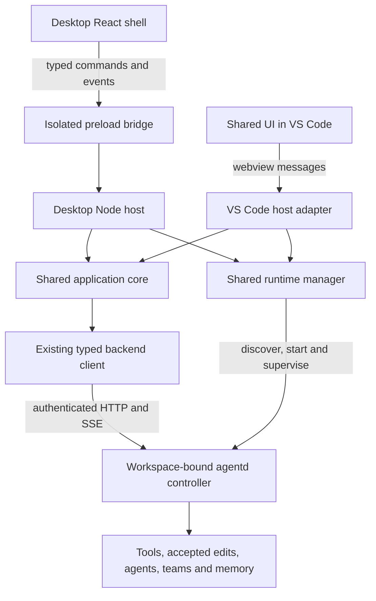

# Crucible desktop: implementation plan

**Consolidation note:** the later Codex/Claude review is recorded in `final-ui-design.md` and `collaboration/merged-ui-proposal.md`. Those documents supersede this proposal where they differ: one controlling app per project is the v1 release behavior; shared leases are later; whole-workspace visibility, palette/attention, user PTY, read-only Git and backend-mediated restore are included/sequenced explicitly. Preserve the source assessment and test requirements below as evidence; do not treat the earlier scope or estimates as an unchanged final commitment.

**Direct reuse constraint:** Pradeep subsequently confirmed that the existing React composer, thread/transcript, gate cards and other suitable components must be reused as the same shared source, not rewritten to match the HTML stand-ins. `component-reuse.md` defines what is reused, what needs a wrapper/host adapter, and the limited new shell work. Prefer mounting the existing chat surface with narrow shared composition hooks; physical package relocation is optional after a working integration.

Design and source assessment, 21 October 2026. This is a proposal, not an implemented desktop application. UI direction revised after the user's Codex screenshots: conversation-first with an on-demand tabbed right workspace, independent pinned summary, and a far-right file navigator. See `ui-spec.md` for the current interaction model.

## Product decision

Build a local desktop agent workspace alongside the VS Code extension. Open a repository, converse with the controller, let it explore and edit, work with sub-agents and teams, inspect changes and command output, and return to previous conversations. Use Electron and React, with shared application code and two platform adapters.

The project instructions are `CLAUDE.md`. Its reactive-controller section and current source take precedence over the historical task lifecycle near the beginning of that document and the older `docs/architecture.md`. The user's explicit direction is to build around the current system and its enabled defaults.

The primary unit in the product is a **conversation**. A turn runs the existing controller loop in `ACTIVE`, or in user-selected `PLAN`. Inline edits handle changes of any size, with the existing todo ledger for multi-part work. There is no mandatory task creation, spec wizard, plan approval, execution-stage timeline, final promote button, or task dashboard. The disabled task subsystem stays disabled.

Start with macOS, the current development environment. Treat Windows and Linux as subsequent release targets, not separate application implementations. The source supports macOS arm64/x64, Windows x64, and Linux x64 runtime assets; additional architectures require additional runtime support.

## Findings from the current implementation

| Area | What is established in source | Desktop consequence |
|---|---|---|
| Agent execution | `chat/controller_factory.py` selects `ChatController`; `controller.py` owns turns; `controller_loop.py` drives tools/actions | Reuse the controller and providers. No new orchestration engine. |
| Phase model | `ACTIVE` is the normal path; `PLAN` is opt-in and sticky; implementation can leave PLAN through the model-authored mode gate | Preserve semantics and the existing implement/feedback flow. Do not reinvent task planning. |
| Edits | `TurnEditSession` stages edits and promotes accepted edits immediately; protected paths and agent trust can still require a gate | Distinguish proposed edits from already-applied working-tree changes. A review inspector is not an implicit transaction boundary. |
| Conversation UI | React, Vite, reducers, transcript, composer, gates, teams, agents, setup, memory and graph entries exist | Extract reusable components and state machinery; create a desktop shell around them. |
| UI transport | UI sends VS Code messages and receives `window` message events; outside VS Code the current API stub does nothing | A plain wrapper would show a nonfunctional interface. Introduce an explicit host bridge. |
| Host application state | `CrucibleController` has one active thread, stream, live-state timer and usage view; `App.tsx` locks navigation when input is disabled | Separate view selection from running work. Merely removing `navLocked` is insufficient. |
| Backend transport | `@crucible/editor-client` already supports typed HTTP, SSE, chat, gates, teams, accounts, memory and usage | Reuse it in a trusted Node host, not in the browser renderer. The package name does not imply an existing desktop editor. |
| Authentication | Backend enforces loopback peer, exact Host, absence of Origin, and bearer authentication | Keep requests in the host process and forward validated events to the UI. Do not relax backend CORS/authentication. |
| Workspace identity | Controller workspace is frozen at process startup; thread listing paths do not retarget file operations | One backend context per canonical repository root. Never switch repositories by only changing a thread's workspace field. |
| Runtime management | Installer and backend-process core avoid VS Code; wrapper supplies settings, secrets, status, restart logic and dependencies | Move pure runtime pieces to a shared Node package; implement desktop dependencies. |
| Runtime reuse | A second host can authenticate and reuse the workspace lock's live backend | Useful discovery mechanism, but not a full two-application ownership protocol. |
| Shutdown | `RuntimeManager.dispose()` stops its process objects; `BackendProcess.stop()` kills children it launched | Closing the launching app can stop work observed in another app. Define ownership before claiming reliable coexistence. |
| Runtime locking | Lock file is atomically written; start checks then spawns; the lock is discovery data, not an OS-level exclusive startup reservation | Add a race-safe startup reservation and test simultaneous desktop/extension starts. |
| Persistence | Repository-local SQLite stores already hold chats, gates, teams, histories and checkpoints | Keep the backend authoritative; desktop owns recent-project metadata, drafts and window preferences. |
| Streaming | Broadcaster retains a bounded in-memory replay buffer (50 events); current host reconciles transcript and `/live` state | Restore from persisted state; do not claim replay gives durable exactly-once streaming or automatic crash continuation. |
| Shared policy | Approval state uses process identity/version; plan preference and provider configuration also have broader scope than an individual UI pane | Display actual confirmed scope. Do not promise independently configurable models/permissions per conversation without backend changes. |
| Credentials | API keys use VS Code SecretStorage; subscription tokens are backend-managed | Add a desktop secure-store adapter for API keys. Reuse backend account registration/token services. |
| File references | Catalog/matching/open-reference logic is reusable; workspace inventory and editor opening are VS Code adapters | Add desktop inventory/file preview while retaining exclusion, canonical-path and stale-reference checks. |
| Distribution | Release workflow already builds runtime assets and a VSIX; it has no desktop installer/update pipeline | Add desktop packaging, signing, update delivery and clean-machine checks. |
| Hidden prerequisite | LSP install invokes system `node` and `npm`; Electron's embedded Node does not supply those executables | Package verified LSP bundles with an executable runtime, or offer explicit degraded support. Do not silently depend on a developer's PATH. |

This is a feasibility and design review of the relevant connected paths, not a line-by-line audit of all backend algorithms. Existing uncommitted UI-test changes were observed and left untouched. No current model/provider behavior, release entitlement, performance, or clean-machine install was tested in this design pass.

## Default behavior contract

Desktop must reuse the managed product defaults, not the defaults from launching bare Python. Derive the environment in one shared builder and query `/v1/config` after launch. Preserve saved user overrides; reflect actual capabilities instead of silently enabling unavailable features.

| Capability | Desktop baseline | Source/qualification |
|---|---|---|
| Reactive controller | On | Managed `buildBackendEnv`: `CRUCIBLE_CHAT_CONTROLLER=1` |
| Task subsystem | Off | Managed env and factory: `CRUCIBLE_TASK_SUBSYSTEM=0` |
| Phase | ACTIVE; sticky PLAN opt-in | Controller phase model and composer state |
| Sub-agents and teams | On | Factory defaults; teams depend on sub-agents |
| Memory and local search-model dependencies | On | Memory configuration and managed local-model setting; preserve optional dependency status |
| Scoped recall, curator, evidence compaction | On | Managed env; inspector must preserve offered/read/used distinctions |
| Skills, MCP | On in managed product | Bare Python resolvers default off; enabled in managed spawn |
| On-demand MCP schema loading | On | Current factory default/extension setting; preserve filters, loaded-state and reconnect semantics |
| Native web search/fetch | On | Managed env; retain their actual approvals and disclosures |
| Background command sessions | On | `CRUCIBLE_EXEC_SESSIONS_ENABLED=1`; this is an existing controller feature |
| Tool batching, adaptive reads, compact context | On | Managed env; reuse scheduling and output policies |
| Approval | Adopt confirmed saved policy; fresh install uses existing Ask fallback | `ApprovalCoordinator`, persisted host preference, backend process/version confirmation |
| Full access | Explicit choice, trusted workspace and first-send acknowledgment | Reuse coordinator/dialog; desktop supplies equivalent trust storage |
| Project instructions | Existing loader behavior | Product currently loads workspace AGENTS.md; using CLAUDE.md as engineering instructions here does not change that runtime contract |

Enabled does not mean configured: MCP without a configured/enabled server should show a useful empty state. On-demand capability loading is internal behavior, not a user workflow step. Do not add an onboarding checklist that requires people to turn on already-enabled capabilities.

## Target code organization

```text
apps/
  desktop/                    Electron main, preload, app lifecycle, packaging
  vscode-extension/           VS Code adapter, activation and command integration
  editor-client/              Existing HTTP client and backend schemas
packages/
  app-core/                   Host-neutral conversation coordination and view models
  app-ui/                     Shared React transcript, composer, gates and inspectors
  host-contracts/             Versioned message envelopes, commands, capability types
  runtime-node/               Installer, process lifecycle, token/health and platform helpers
services/
  agentd-py/                  Existing controller, tools, memory, agents and teams
  indexer-rs/                 Existing parsing, graph and language-server integration
```

These package names are proposed. Root npm workspaces currently include only `apps/*`; introducing `packages/*` requires explicit workspace, build-order and test configuration changes. Keep browser-safe dependencies separate from Node-only runtime modules. Reuse editor-client contracts where they exist rather than creating parallel wire schemas.

Target request flow:



Both hosts use the same core implementation, but each process has its own instances. This is shared code, not a single in-memory application singleton.

## Host bridge and application state

Expose a small typed API through an isolated preload: send a validated application command, subscribe to validated application events, and invoke named native capabilities. No general filesystem, arbitrary URL fetch, raw shell, arbitrary IPC channel or unrestricted `ipcRenderer` export.

Envelope identity includes protocol version, client instance, workspace ID, thread ID where relevant, request ID and backend process identity. Events are routed to the matching workspace/thread store even when another conversation is visible. Gate decisions include exact gate IDs; a stale or already-resolved gate refreshes current state instead of being applied to a different gate.

Keep transport sequence markers distinct from backend event cursors: a locally generated sequence cannot provide server replay guarantees. Hydrate persisted transcript and `/live` state after reconnect, then deduplicate supported event identities. Preserve existing handling for transient activity versus durable transcript content.

Split the current controller carefully:

1. Extract host-neutral interfaces and message handling without behavior changes; keep the extension working.
2. Add a WorkspaceContext registry with canonical paths and a backend client per workspace.
3. Add per-thread state/subscription coordinators and a separate selected-thread pointer. Preserve context/usage epoch guards.
4. Keep the background attention feed cheap. Subscribe to full agent/team details only when inspected.
5. Persist draft text and selected context per workspace/thread; keep attachment data in bounded local storage rather than serializing large images into window state.

V1 allows viewing other conversations while work continues. Initially enforce one **new user-started main turn per repository** across clients; existing sub-agents, teams and notice turns keep their current behavior. This is a proposed scheduling restriction until global provider, phase and policy interactions are verified, not a claim about today's backend. Do not stop an existing team just because the user navigates. The UI explains when a second send must wait; do not invent a generic queue endpoint. Later independent simultaneous main turns can be enabled after a concurrency audit.

## Runtime ownership and two-app coexistence

Do this before marketing both applications as interchangeable views of ongoing work.

- Canonicalize workspace roots, including symlinks and platform path rules, before selecting a runtime.
- Keep the existing token/health proof and PID/workspace verification. Add protocol and runtime version negotiation.
- Add an exclusive startup reservation around discovery/start; a JSON lock written after bind does not serialize two simultaneous startups.
- Add authenticated client registration/heartbeat and an ownership lease. Multiple clients may observe; one client controls workspace-wide configuration and starts user work. A takeover is explicit, idle-only, and preserves confirmed backend policy. Decisions must follow a documented owner/gate rule.
- Enforce ownership at backend mutation boundaries, including settings, turn creation, approvals and stop actions. Client-only button disabling is insufficient. Approval policy's existing `owned` bit is not a client lease and must not be repurposed as one.
- Preserve runtime availability when the initiating client disconnects while another client or active work remains. Make process supervision independent of renderer lifetime. Establish the supported detached launch behavior per OS in the technical spike.
- Separate renderer close, project close, app quit and Stop work. Explicit Stop is the existing backend operation; changing a panel never sends it.
- Do not restart or upgrade an active/shared runtime automatically. Schedule upgrades when idle and check all connected-client compatibility.
- Use versioned immutable runtime installations, or an equivalent installation-wide lock, to prevent the desktop installer modifying a Python environment that the extension is executing.
- Update the extension adapter with the same lease protocol. In a lease-enforced shared session, an older client cannot retain unrestricted legacy writes: backend rejects them with an upgrade/ownership error. Do not break ordinary supported single-host legacy mode accidentally.

Fallback for the earliest internal prototype: only one host opens a repository at a time, with a clear already-in-use view. That prototype is not the release coexistence solution. A separate global supervisor daemon is a possible later implementation, not assumed necessary before the process-lifetime spike.

## Storage and migration

Backend remains authoritative for conversations, gate status, controller history, checkpoints, teams, agent records, memory, provider account tokens and command sessions. Reuse the existing per-repository `.crucible` stores and APIs; no second chat database in Electron.

Desktop app data contains a versioned recent-project registry, window bounds, panel widths, appearance, drafts and trust acknowledgments. API keys use a secure-store port with no renderer readback. Verify platform behavior, particularly Linux credential-store availability, and report failures without falling back to plaintext silently.

VS Code SecretStorage is not a portable credential file. Do not promise automatic key migration. Existing backend-managed account registrations can be discovered through their current services; API-key users reconnect or explicitly import through a supported flow. Keep global preferences versus repository overrides explicit, and show the backend-confirmed settings when attaching to an already-running workspace.

Reopening a conversation restores saved history. Reattaching to a live backend resumes observation. Restarting a dead backend can leave interrupted work failed; the app must say so and offer an appropriate follow-up. These are three distinct outcomes. Rewind stays the existing preview/confirm API, with its external-side-effect limitations and busy checks.

## What ships in the first usable version

Repository picker/recent projects; conversations; text and image context; provider-native model/effort controls; ACTIVE/PLAN; approvals and exact gate decisions; persistent history/drafts; working-tree-aware change inspector; read-only file previews; command-session transcripts; sub-agent and team inspection; settings/setup; memory and AXON entry points; runtime status and recovery.

Existing enabled systems stay on. Full parity for memory/AXON screens can arrive after the first vertical slice, but they are not disabled in the engine while awaiting UI integration. Settings and composer must remain capability-driven.

Manual source editing, a full PTY terminal UI, Git staging/commits, branch/worktree creation, remote workspaces, cloud execution and extensions are later scope. Existing agent command sessions still execute and their output is inspectable. Opening files in VS Code is a useful native action. The Changes inspector describes Crucible changes, not a fabricated Git staging area.

## Delivery stages and acceptance gates

| Stage | Work | Indicative effort | Acceptance gate |
|---|---|---:|---|
| A — extraction and technical spike | Freeze controller/defaults contract, identify bridge types, test detached lifetime and packaged LSP strategy, extract a narrow seam | 2–3 engineer-days | Extension still builds; documented result for runtime lifetime, trust and external executable assumptions |
| B — desktop vertical slice | Electron app, preload, selected project, shared runtime startup, existing setup, one real conversation/edit/gate | 4–6 days | A clean local project can complete ACTIVE → edit → correct approval behavior without task APIs |
| C — desktop shell and inspectors | Sidebar, project switching, composer, transcript, changes/file/output views, agent/team navigation | 5–7 days | Required states from UI spec are usable and keyboard accessible; no copy of the agent engine |
| D — lifecycle and coexistence | Per-thread routing, snapshots, drafts, attention, startup reservation, leases, close/quit behavior and compatibility | 5–7 days | Two supported clients attach safely; navigation and renderer reload do not cancel active work; stale decisions cannot hit another gate |
| E — enabled-feature parity | Provider setup/accounts, skills/MCP controls, memory/AXON, default/capability checks, trust and rewind | 4–6 days | Default-on features remain available; disabled task UI stays absent; persisted settings match confirmed backend state |
| F — release hardening | Installer/signing/updater, immutable runtime updates, packaged LSPs, crash/sleep recovery, accessibility and clean-machine checks | 7–10 days | Signed package tested through install, first use, update and uninstall on the release platform |

Base estimate: **27–39 engineer-days**, plus **5–8 days contingency** for lifecycle/packaging findings. These are engineering estimates, not benchmarked delivery promises; parallel coding tools do not eliminate integration and platform validation.

Practical checkpoints: prototype in 1–2 weeks; daily-use alpha around 4–6 weeks; supported macOS release around 7–10 weeks; all three desktop platforms around 9–12 weeks if signing/distribution access is ready. A second engineer can overlap UI and packaging after the core contracts settle. This refines the earlier optimistic estimate: reliable coexistence, enabled-feature parity and clean-machine runtime support were not included in a thin-wrapper estimate.

Critical path: bridge extraction → real conversation/edit slice → lifecycle/ownership → packaged runtime → signing/update verification. Do not spend the first milestone redesigning the agent loop.

## Verification plan

Run existing workspace build, typecheck and relevant controller/approval/runtime tests at extraction boundaries. Check Python tests with the **managed feature configuration**, since `tests/conftest.py` deliberately disables sub-agents, teams and on-demand loading for unrelated tests. Passing the default fixture suite alone does not establish shipped-default parity.

New meaningful integration checks:

1. Managed defaults: controller on, tasks off; enabled memory/agents/teams/MCP/skills/exec sessions preserved; saved overrides survive restart.
2. ACTIVE can explore/edit without creating a task. PLAN disallows the controller edit action and exits through implement; sticky state acknowledges correctly. Preserve existing exec-session availability and approval semantics in PLAN; do not claim it is a filesystem sandbox or a blanket command prohibition.
3. Ask/Accept edits/Full access use backend-confirmed process/version policy; protected-path and child gates retain their independent rules.
4. Multiple gates from different agents route by workspace/thread/gate ID; competing decisions resolve once and stale UI refreshes.
5. Background conversation navigation, renderer reload and stream disconnect rehydrate without resubmitting the user message or cancelling work.
6. Backend restart reports interruption truthfully; lost live work is never represented as successfully resumed.
7. Two-host simultaneous startup, owner/observer attach, idle takeover, owner quit, crash, stale lease and version mismatch.
8. Project switching between roots with spaces/symlinks cannot read, edit or approve in the previous root.
9. Pending edit preview, already-applied changes, manual concurrent edits and rewind busy/stale checks have distinct behavior.
10. Image attachment boundaries, draft restoration, large/truncated/binary/missing file previews and output caps.
11. Fresh machine without system Python/Node/npm; cold model download, missing optional LSPs, offline retry, app sleep/wake and interrupted upgrade.
12. Keyboard navigation, focus restoration, scalable text, contrast and reduced motion; actual native app at common window sizes.

Do not add tests that merely mirror static CSS. Use layout smoke checks for the design prototype and behavior checks for the real application.

## Open decisions and assumptions

- Use the revised **conversation-first** layout with optional pinned summary and tabbed right workspace. This supersedes the initial persistent-inspector recommendation. Include file tabs, navigator filtering, rendered Markdown/source and expand/restore state in Stage C; preserve per-conversation view state in Stage D. A read-only host file-preview port must enforce canonical workspace boundaries and existing inventory rules. Layout similarity does not add Git actions to the backend scope.
- macOS first is an assumption, not a user-stated release requirement.
- Confirm whether manually editing files or typing into a terminal belongs in V1; neither is needed for the requested agent workspace.
- Validate a detached, safely supervised runtime per OS before choosing whether a dedicated supervisor is warranted.
- Decide packaged LSP executable strategy in Stage A; Electron by itself does not satisfy the existing installer.
- Specify model/policy scope in the UI according to current backend behavior. Independent per-thread providers need a separate backend change.
- No implementation, publishing, release signing or account changes have been performed as part of this design request.

## External technical references

Electron's [process model](https://www.electronjs.org/docs/latest/tutorial/process-model), [context isolation](https://www.electronjs.org/docs/latest/tutorial/context-isolation), [IPC guidance](https://www.electronjs.org/docs/latest/tutorial/ipc), and [security guidance](https://www.electronjs.org/docs/latest/tutorial/security/) support the main/preload/renderer boundary. The Electron recommendation is an inference from those capabilities and this repository's existing Node/React code, not an externally measured framework comparison.

[Packaging](https://www.electronjs.org/docs/latest/tutorial/tutorial-5-packaging) and [code signing](https://www.electronjs.org/docs/latest/tutorial/code-signing) are separate release work, including stable signing identity for secure-storage behavior.
