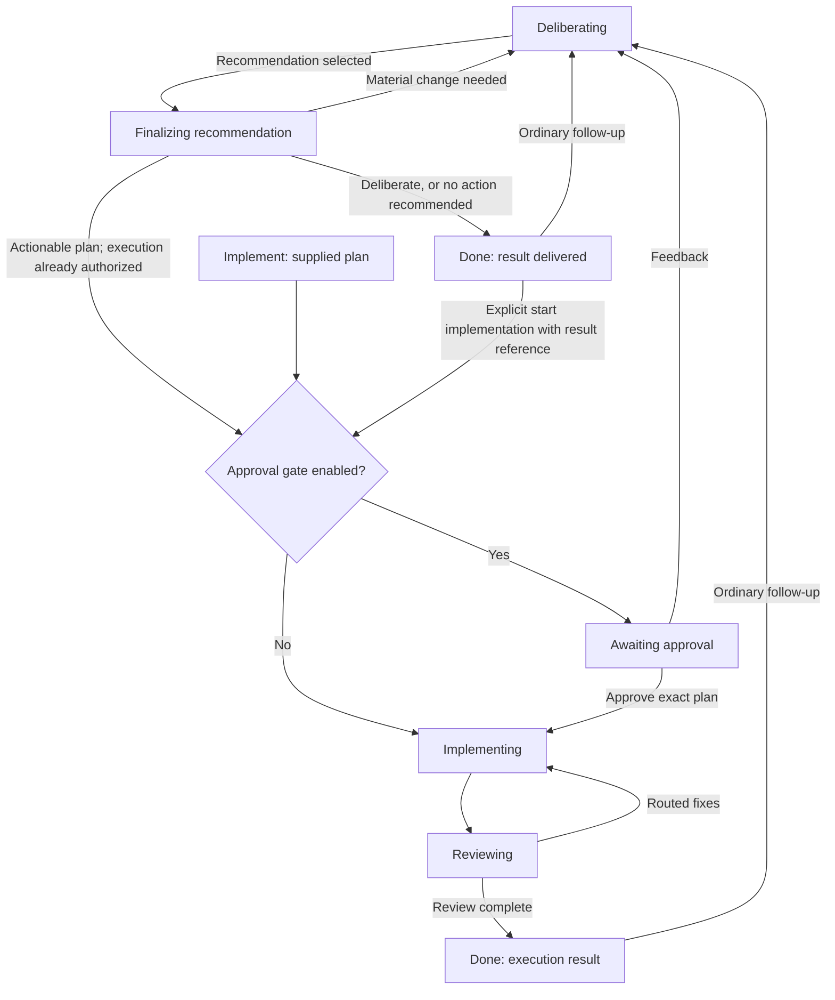

# Team execution modes, lead finalization, and main–lead conversation

Date: 2026-10-15  
Status: Implemented on branch `codex/team-execution-modes` after independent review on 2026-10-16. See the companion implementation eval for verification and live-smoke limitations.  
Companion: `docs/superpowers/plans/2026-10-15-team-execution-modes.md`

Extends the current implementation of `2026-10-02-subagents-v2-design.md` and
`2026-10-07-team-lead-proposer-design.md`. Current code takes precedence over historical
documents: the vote-round design was superseded, DONE teams already reopen through
`post_board`, and team reports and main-agent milestone delivery already exist.

## 1. Problem and agreed product contract

Today a proposal with assignees becomes executable when the team adopts it. A lead telling
members to wait only delays this transition. A user asking for a plan, diagnosis, review,
or comparison can consequently receive implementation work they never requested.

The agreed behavior is:

1. Main chooses **Deliberate**, **Deliberate and implement**, or **Implement** explicitly.
2. Deliberate finishes with a useful deliverable, not necessarily an implementation plan.
3. **Finalizing recommendation** is a real phase in which the lead synthesizes the result.
4. Main and lead can converse directly without waking the other members.
5. The existing report and milestone paths carry results to main. Do not add a competing
   completion delivery system or make main reopen the board just to obtain reports.
6. Main can explicitly extend a completed deliberation into implementation using the same
   team and its retained context.
7. Ordinary follow-up discussion reenters deliberation. It does not authorize execution.
   The existing DONE → deliberation behavior of `post_board` is retained.
8. Implement starts directly from a supplied plan, without manufactured consensus rounds.
9. Agreement, assignments, report publication, and messages are not execution authority.

This specification supplies concrete engineering choices below. Names, wire fields,
limits, and migration defaults are proposals for review, not additional requirements the
user separately specified.

## 2. Code investigation and current behavior

Paths in this document are repository-relative. The investigation used the current working
tree, including existing uncommitted frontend changes. Those changes must be preserved.

### 2.1 Backend map

| Area | Files and responsibilities |
|---|---|
| Records and database | `services/agentd-py/agentd/teams/models.py`, `store.py`: team/member/post/activity records, additive SQLite migrations, separate post `seq` and activity `aseq`, monotonic delivery cursors, usage, restart cleanup and rewind deletion |
| Main/member tools | `teams/tools.py`: creation parsing, roster/lead/budget validation, `MainTeamOps`, main tool registry, member `team_*` tools, background/delegation response |
| Board and member input | `teams/service.py`, `validation.py`: proposal/stance preparation and commit, lead-only proposing, assignment validation, direct-message visibility, round cutoff, prompts/status, reports and summaries |
| Lifecycle | `teams/state_machine.py`, `coordinator.py`, `adoption.py`: pure transitions, side effects and scheduling, round adoption, deadlines, retries, approval, budget/stuck/provider pauses, implementation and review |
| Execution and review | `teams/scope.py`, `implementation.py`, `review.py`, `report_fields.py`: edit ownership, report validation, peer waits, objection routing, stance/proposal fields |
| Main integration | `chat/controller.py`: creation, DONE reopening, FAILED revival, member/helper activation, permissions and edit protection, report routing, live/detail views, gates, notices, rewind/restart handling |
| Model guidance | `chat/controller_prompts.py`, `controller_loop.py`: report schemas, main/member teaching, live-work hints, notice/delegation dedup and forced reports |
| Delivery and permissions | `subagents/notices.py`, `permissions.py`, `context.py`, `runtime.py`; `tools/sources.py`, `registry.py`: notice batching, inherited permissions, activation scheduling, tool preparation/execution |
| HTTP and diagnostics | `api/routes.py`, `chat/models.py`, `teams/config.py`, `trace.py`: team reads/disband/approval routes, model schemas, limits, coordinator JSONL trace |

### 2.2 Frontend and transport map

| Area | Files and responsibilities |
|---|---|
| Public client contract | `apps/editor-client/src/contracts/task-contracts.ts`: Zod schemas for summary/detail/live/post/activity/gates and stream events |
| Wire mapping | `apps/editor-client/src/client/http-backend-client.ts`: snake_case → camelCase mappings, team REST calls and event parsing |
| Host subscription | `apps/vscode-extension/src/team-views.ts`: detail backfill, stream follow, independent cursors, terminal final backfill |
| Host integration | `src/controller.ts`, `chat-panel.ts`, `extension.ts`: `/live` dedup, roster/summary refresh, open-board management, UI bridge and plan decisions |
| Webview state | `webview-ui/src/types.ts`, `hooks/useAppState.ts`, `teams.ts`: mirrored contracts, merges, phase updates, active/terminal decisions, tool-pill links |
| Team surfaces | `components/teams/{TeamCard,TeamStrip,TeamWindow,PhaseStepper}.tsx`, `ThreadView.tsx`: transcript card, pinned live strip, board/member window and progress path |
| Timeline and transcripts | `teamJourney.ts`, `teamChapters.ts`, `components/teams/{Journey,RoundItems,MemberView,PostBody}.tsx`: chapters, round verdicts, directed posts, activity, member reports and Markdown |
| Related presentation | `teamIdentity.ts`, `components/teams/{Avatar,TeamLinks,TeamsContext,TeamUsage}.tsx`, shared agent transcripts/report disclosure, `components/messages/gates/TeamPlanGate.tsx` |

### 2.3 Findings that affect the design

- `state_machine._adopt` ends immediately if there are no known assignees. Otherwise it
  opens an approval gate or calls `_implement`. There is no execution-mode field.
- `create_team` describes a team that deliberates and then implements. Both kickoff forms
  enter deliberation; no direct implementation kickoff exists.
- The lead is already the only proposer. Its unobjected proposal cannot be revised, and
  the lead is deliberately left idle while reviewers finish. Refusal text and round headers
  say small notes will be applied **during implementation**. Plan-only synthesis must
  incorporate those notes without reopening a proposal on every editorial amendment.
- Proposal preparation calls `check_assignments`, including checking whether a named
  future owner can edit. Planning metadata and executable assignments are conflated.
- `_team_member_reported` stores activation wrap-ups; `TeamService.report` returns the
  latest report from each member, proposals, and objections. Reports are already durable.
  Member activity text is capped at 20,000 characters; on-demand member text defaults to
  8,000 characters; completion summaries use the first nonempty line, capped at 240.
- Automatic `done` milestones include member summaries after implementation/review.
  Deliberation with no assignees instead emits `adopted`; its body has assignments and
  next-step text, not all reports inline. Its instruction to main to “carry it out or tell
  the user” is incompatible with deliberate-only scope.
- `team_milestone` already wakes/notifies main through the notice machinery, or appends to
  main's active inbox. It does not wake team members. System board posts are also passive
  because `TeamCoordinator.on_post` ignores `kind == "system"`.
- Board visibility is not equivalent to waking everyone. During deliberation, posts/DMs
  are held to the next round. During implementation, only recipients/mentions wake.
  `on_post` has no live wake branch for REVIEWING despite some guidance saying delivery is
  immediate there. New private communication needs an explicit route, not that assumption.
- Main currently only has `post_board`; member `team_message` only accepts roster members.
- DONE reopening already clears assignments and adopted/closing pointers, restores quorum,
  advances rounds, and allocates fresh budget while retaining transcripts and history.
  FAILED revival instead restores the previous phase. These behaviors are different.
- Non-implementation activation removes `edit`, and `TeamProtection` also checks phase
  when edits apply. Helpers inherit team protection. However, phase alone does not remove
  arbitrary shell/MCP tools; a prompt prohibiting shell writes is not enforcement.
- `TeamViewManager` exits its follow loop on terminal backfill, but retains the open entry.
  `setOpen` skips an existing entry and `/live` has no equivalent of agent `noteActivation`.
  A still-open completed board can therefore miss a later reopening.
- Frontend steps are hard-coded to Kickoff → Deliberating → Implementing → Review → Done.
  The special `endReason == "adopted"` case is plan-specific. New mode/result semantics
  must replace this inference.
- Notice-turn hints currently discourage both `team_status` and `team_report` as redundant.
  A notice containing only compact status cannot simultaneously be treated as containing
  the full deliverable. Completion delivery must make this consistent.
- Live teams are duplicated in `models.LIVE_TEAM_PHASES` and `state_machine.LIVE_PHASES`;
  the former is derived by slicing `TEAM_PHASES`. Adding a phase must update both safely.
- Team budgets are stored as an absolute ceiling over lifetime requests. DONE reopening
  adds a fresh allowance to lifetime usage, while resume caps the absolute ceiling at
  `team_max_budget`. Reused teams need a consistent per-run allowance calculation.
- `team_activity` and trace are best-effort diagnostics. They cannot become the sole
  durable source for execution permission, completion results, or pending communication.

## 3. Concepts and invariants

### 3.1 Mode, phase, and deliverable

`mode` is the requested workflow for the current run:

| Wire value | Display | Meaning |
|---|---|---|
| `deliberate` | Deliberate | Produce the requested analysis and stop |
| `deliberate_and_implement` | Deliberate and implement | Develop a recommendation, finalize it, execute an actionable plan, and review |
| `implement` | Implement | Execute the supplied plan, subject to existing approval policy, then review |

`phase` is the current activity. Add `FINALIZING`, displayed as **Finalizing recommendation**.

`deliverable` is `{kind, description}`. Proposed kinds: `plan`, `review`, `diagnosis`,
`comparison`, `recommendation`, `custom`. `description` states the acceptance criteria,
including desired depth/format. A review of an existing design remains deliberation;
`REVIEWING` continues to mean verification after execution.

A run is a work cycle on the same team. `run_id` starts at 1 and increments when a completed
team receives a new work request or starts a separately authorized implementation run.
Private consultation does not create a new run. A failed run's revival keeps its run id.

### 3.2 Required invariants

1. `mode == deliberate` never enters IMPLEMENTING, including via adoption, gate approval,
   deadlock override, resume, restart revival, private reply, or stale member output.
2. Only IMPLEMENTING permits implementation edits, and base agent permissions still apply.
3. Proposed owners/files never grant editing permission or acquire active file ownership.
4. Publishing or reading a result schedules no member activation. Completion wakes main.
5. Finalization schedules the lead only, with full relevant round evidence available.
6. A material change to the agreed recommendation returns to deliberation; formatting and
   incorporation of already agreed notes do not create another consensus round.
7. A report/reply is correlated with its run and activation purpose. A late response cannot
   finish another run, mark an assignment done, or replace the accepted result.
8. Main can act on prior explicit implementation authorization without asking again. An
   agent-authored message or notice cannot create that authorization.
9. Old results remain inspectable after reopening. A new consultation report never replaces
   the accepted deliverable simply because it is the lead's latest wrap-up.

## 4. Lifecycle



Existing DEADLOCKED, PAUSED, FAILED and DISBANDED paths remain, with the new fields and
FINALIZING included in their guards. A completed deliberate result is DONE, not PAUSED or
AWAITING_APPROVAL. No user implementation card appears merely because a plan was produced.

### 4.1 Deliberate

Creation starts deliberation. A proposal is a candidate answer/recommendation and can have
no assignments. Existing rounds and stance rules apply. Adoption selects the basis of the
answer and enters FINALIZING regardless of assignment count. After a valid lead result,
the team ends with `end_reason = "deliberation_complete"`.

The result may conclude `no_change` or `needs_decision`. Neither outcome is failure. A
deadlock remains visible; main can select an open proposal with `adopt_proposal`, which
finalizes with `selected_by = main` and includes dissent. Do not label it unanimous.
If there is no suitable proposal, main supplies direction through the existing board
round. Forcing arbitrary early finalization without a candidate is deferred.

### 4.2 Deliberate and implement

Adoption enters FINALIZING. A result with an actionable execution plan proceeds to the
existing approval gate or implementation. A result of `no_change` or `needs_decision`
finishes with a recommendation, without inventing assignments to reach implementation.

Finalization must preserve the adopted execution scope. If the lead discovers materially
different work, it reports `needs_deliberation` and a reason; coordinator opens another
round, subject to budget/round bounds. At the round limit it returns to DEADLOCKED rather
than silently granting unlimited rounds.

For this workflow, an `actionable` result must have a valid executable mapping before
automatic continuation. If owners or execution scope still need a decision, the lead
returns `needs_decision`; the team completes with that explicit limitation instead of
silently running an empty plan or inventing a mapping.

The adopted system event can record the selection, but the automatic main wake at that
moment is suppressed while finalization is pending. Main receives one useful
`recommendation_ready` milestone with the result and the actual next phase. This avoids
an “adopted, now implement” instruction racing a lead who has not finalized the plan.

### 4.3 Implement

Requires `kickoff.kind == proposal`, concrete text, and nonempty validated assignments.
The supplied plan is recorded as main's execution instruction, not as team consensus.
There are no deliberation or finalization activations before execution. With
`approval_gate=true`, it first enters AWAITING_APPROVAL. Review/fix cycles are unchanged.

Approval feedback enters deliberation with workflow `deliberate_and_implement`, because
feedback requests a revised plan before the already requested execution. Rejection ends
the team. This mode change is explicit in the decision handler and activity record.

### 4.4 Follow-up versus extending into execution

- `post_board` to DONE keeps the current reopen mechanism, but the new run defaults to
  `deliberate`, including after a previous implementation run. A question such as “why
  this design?” must not inherit old authority to make changes.
- Starting execution uses `start_team_implementation`, referencing the accepted result
  and expected run. It creates a new run in `implement` mode on the same roster/history.
- Starting requires DONE, no active consultation, no pending lifecycle activations, and
  a valid executable plan. During FINALIZING it returns a clear “result not ready” error.
- A deliberation-only roster may contain agents whose definitions cannot edit. Execution
  validates real capabilities again; it may use an already capable member, otherwise main
  must create a suitable implementation team. This feature never upgrades definitions or
  trust. Choose capable definitions initially when later implementation is likely.
- Changing names/roles, adding members, and transferring lead are outside this change.

### 4.5 Narrowing a running request

`set_team_mode(..., mode="deliberate")` supports narrowing; widening uses the explicit
start operation. Narrowing during deliberation/finalization updates the continuation
policy. Narrowing during implementation/review first prevents new execution work, cancels
pending implementation approvals, stops/drains active members and helpers, and then starts
a deliberation run reflecting work already performed. Do not claim or automatically undo
earlier edits. A command already launched may finish before cancellation; report that fact.
Every queued action rechecks run/mode/phase at execution time. Stale reports are retained
for inspection but cannot advance the replacement run.

## 5. Lead finalization

Introduce pure state-machine events/actions equivalent to `BeginFinalization`,
`FinalizationReported`, and `StartFinalization`, rather than treating a lead's completed
report as an implementation assignment completion.

The lead receives:

- Selected proposal and its assignments as proposed metadata.
- All relevant board posts through the completed round's end, including agree-notes and
  objections. Other members' private DMs remain private.
- Current-run member reports, supplied explicitly by the coordinator. Diagnostic activity
  remains excluded from ordinary member board input; this is intentional report input.
- Deliverable description, selected-by/consensus status, and the permitted continuation.

Finalization has no ordinary deliberation cutoff; its input snapshot is taken after the
round completes. Do not reuse an older `round_cutoff_seq` and omit the last reviewers.
Clear the active cutoff on leaving deliberation while retaining historical round records.
Use durable agent report/transcript records with run/activation correlation for this input;
do not require the best-effort `wrapped_up` activity write to have succeeded.

The lead completes using the existing `report` action with an optional team-only field:

```json
{
  "type": "report",
  "thought": "Synthesized the reviewed recommendation",
  "status": "completed",
  "summary": "Full Markdown deliverable, including evidence and open questions.",
  "final_result": {
    "summary": "Concise result for main and the team card",
    "outcome": "actionable",
    "basis_proposal_id": "P7"
  }
}
```

Proposed `outcome` values: `actionable`, `no_change`, `needs_decision`. An actionable
diagnosis can recommend further work without itself supplying an execution plan. Continuing
automatically additionally requires a valid executable assignment set.

Analysis scopes may name directories. Publishing a deliberate recommendation, or a
`no_change`/`needs_decision` result, fingerprints concrete files and records directory
scopes separately. Directory scopes require a revised concrete file map before later
implementation; they must not fail result publication or become broad editing authority.

`final_result` is accepted only from the lead in a finalization activation of the expected
run. Its Markdown comes from the existing report's `summary`, not a duplicated text field.
The concise summary is at most 1,000 characters; full result text at most 20,000. Oversized
or empty required output gets a repair response, not silent truncation. `partial`, forced
budget output, provider failure, or missing final metadata cannot mark finalization complete.
Use existing retry/provider/budget policies; pause with a clear finalization reason when
the lead cannot produce a valid result. Normal finalization uses the existing deliberation
40-iteration ceiling and active-time deadline/grace policy; it does not consume a debate round.

Record a durable `kind="result"` post authored by the lead, with `run_id`, mode, deliverable,
basis proposal, selection/consensus metadata, concise summary, and outcome in payload.
Store its sequence as `result_seq`. It is a passive result publication: the coordinator
must not route it as a new discussion post. Then reuse the normal wrap-up and milestone
path. A typed `needs_deliberation` finalization response restarts debate instead of
publishing an accepted result; define that response alongside the report validator.

The lead folds in already agreed notes without `team_propose`, avoiding the current
unobjected-plan revision guard. It cannot silently alter execution assignments/files.
The result links to the selected immutable proposal so the exact execution scope is known.
Use a dedicated result validator rather than globally increasing the existing 8,000-character
board-post limit. A revision request is a report with
`status: completed`, `finalization_feedback: {reason: string}` and no `final_result`.
`partial` pauses finalization; it does not request another debate. `needs_deliberation` names
the internal transition, not an additional successful-result outcome.

Carry this structured report metadata from `ControllerOutcome.payload` through the child
result/report-routing boundary. `ChildResult` currently contains only status, report text,
files and stale-refusal count; adding a schema field alone would lose its metadata there.
Validate before acceptance and commit the final result only at the correlated successful
report boundary. Do not recover metadata by parsing the Markdown answer.

## 6. Main ↔ lead conversation

### 6.1 Proposed tool surface

| Actor | Tool | Behavior |
|---|---|---|
| Main | `message_team_lead(team, text, expected_run_id, extra_budget?, retry_request_seq?)` | Resolve the recorded lead role; persist a directed request; schedule/deliver only to lead |
| Lead | `team_reply_main(text, request_seq?)` | Persist a directed reply and notify main through existing team notices; never wake a member |
| Main | `cancel_team_lead_request(team, request_seq, expected_run_id)` | Cancel one pending exchange and its dedicated consultation work without disbanding the team |

Keep `team_message(member, text)` for member-to-member conversation. A separate lead reply
tool avoids interpreting a roster label named `main` or `lead` as a reserved role. Main's
tool resolves the stored `team.lead`; it does not parse `@lead` in arbitrary text.

Both tools use normal untrusted-content framing. Main's request is not a new user message
and cannot loosen an agent definition, gate, mode, or file boundary. Only lead may reply
through this route. Allow the lead to send an unsolicited substantive question to main by
omitting `request_seq`; the same durable/notification rules apply, with rate limits.

Use directed `kind="post"` records with `recipient=<lead label>` / `recipient="main"` and
payload `channel="main_lead"`, `run_id`, `reply_to` (when applicable). This reuses existing
post sequences, UI, and visibility filtering. A reply recipient is a role selected by the
tool, not by generic mention parsing. Existing legacy roster labels remain interpretable.
New rosters reserve `main`, `user`, `system`, and `team` to avoid new author ambiguity;
legacy ambiguous labels require an explicit compatibility check rather than reinterpretation.
Unsolicited lead→main questions are limited to one per activation, within the existing
post/wake/budget caps. When replying to an outstanding request, its sequence is required;
an unsolicited post does not implicitly resolve it.

### 6.2 Scheduling and phase independence

| Situation | Delivery |
|---|---|
| Lead currently working | Direct inbox input at the next safe loop step; no second simultaneous activation |
| Lead already owes the current deliberation round | Add request to that activation's input; keep its round responsibility |
| Lead idle while peers finish a round | Lead-only communication activation, separate from the round's reported set |
| IMPLEMENTING/REVIEWING | Route the exchange separately from board wake policy; it never counts as completion of a work assignment or review stance |
| FINALIZING | Deliver request to lead; a material revision is deferred to a new deliberation round before acceptance |
| DONE | Bounded, read-only lead consultation; team result and lifecycle stay DONE |
| PAUSED, AWAITING_APPROVAL | Store request as pending; do not bypass pause or approval by waking work |
| FAILED | Return recovery-required without auto-reviving execution for a conversation |
| DISBANDED | Reject; team remains closed |

Private control requests are deliberately outside ordinary round-snapshot delivery. This
exception must not expose same-round peer posts or allow same-round proposal stances.
Maintain a separate delivered marker for private requests: advancing the board cursor past
a private request would otherwise discard held public posts with lower sequences.

Allow at most one unanswered main→lead request per team in this version. A second call
returns its pending sequence and status instead of queuing unbounded activations. The
lead can reply with an answer or explain that it needs a team round. Asking for the final
result can return the existing deliverable; it does not implicitly finalize or reopen work.
Main explicitly uses `post_board` when it wants a new team deliberation.

Persist the pending request sequence separately on the team; reply commit clears it
atomically. A request is resolved only by a reply referencing it, not merely any lead
wrap-up. A failed/partial consultation leaves an actionable pending/blocked exchange status.
On retry, reference the same sequence; a delivered reply is not emitted twice.
Cancellation clears the pending pointer with a durable resolution record. Stop only work
whose purpose is that consultation; if lead is doing lifecycle work, remove the private
obligation without cancelling its assignment/round. Replies racing cancellation remain
visible but cannot resolve a newer request or generate a completion notice for it.

DONE consultations require an activation purpose distinct from lifecycle work. They use
existing agent scheduling, transcript, usage, and tool infrastructure, but bypass the
“must be a live team” start check only for this bounded purpose. They never call the normal
round/assignment report transition. They use remaining run budget; `extra_budget` can add
allowance only in a user-started turn, within the normal cap. Exhausted consultation cannot
silently receive fresh budget or reopen implementation. Apply current live-team admission
limits to teams with active consultation, as well as ordinary live teams.

### 6.3 Visibility and activation matrix

| Event | User sees it | Other members receive it | Main wakes | Member wakes |
|---|---|---|---|---|
| Public board post | Yes | According to current board/round rules | No automatic new path | Existing mention policy |
| Main→lead request | Yes, directed | No | No | Lead only, subject to phase policy |
| Lead→main reply | Yes, directed | No | Yes, existing notice batching | None |
| Accepted result publication | Yes, result card | Can read when next activated | Once via completion/recommendation milestone | None |
| `team_report` read | Existing tool output | No | No | None |
| Lifecycle activity/system record | Yes | Existing system-input rules | Only if an explicit milestone also exists | None by publication alone |

Material decisions derived from private conversation must be put onto the board before
members act on them. This is a content responsibility reinforced by prompts; private
messages themselves do not mutate executable scope.

## 7. Main tools and authorization

### 7.1 Creation

Add required `mode` and `deliverable` to `create_team`. Preserve name/goal/lead/members,
limits, kickoff forms and `approval_gate`. Require a proposal kickoff for `implement`.
Tool descriptions/examples must explicitly distinguish all three workflows and include
the already required `lead` field (some current prompt examples omit it).

New callers omitting mode receive an actionable input error. There is no silent
“deliberate and implement” fallback at the agent-facing creation boundary.

Team mode is distinct from main's existing PLAN/ACTIVE controller phase. An explicit main
PLAN request cannot launch an executing team as a delegation escape: creation permits
`deliberate` only, and the explicit execution tool is rejected until the normal user-authorized
main mode transition permits execution. Pass the actual current loop phase/policy into
the tool operation; do not infer it solely from the controller's global `_plan_mode` flag.

### 7.2 Explicit extension

```text
start_team_implementation(
  team,
  expected_run_id,
  result_seq,
  assignments?,
  shared_files?,
  approval_gate?
)
```

Main may reuse assignments from the result's basis proposal or provide an executable
mapping when the recommendation described work without a capable owner. Main's supplied
mapping becomes a new immutable execution-instruction proposal linked to `result_seq`.
An explicitly supplied empty set is invalid. Validate ownership, protected paths, real
definition capability, shared/owned conflicts, live-team capacity, and expected run/result.
The result text stays unchanged and its original proposed mapping remains visible.

This operation is allowed from a user-started turn carrying implementation intent.
An automatic completion notice cannot promote a deliberate run into execution. For
combined mode, the coordinator's existing upfront continuation is the authority; it
does not ask main to call this tool. There is no semantic classifier pretending to prove
user authorization: the runtime enforces the user-turn boundary and explicit operation;
main's guidance enforces the user's actual scope.
The start operation carries its source result and source run in the durable execution
instruction, so a retry can find the original run before rejecting the now-older
`expected_run_id`. Comparing only the current run id would incorrectly turn
every successful retry into a stale-request error.

Before extending a previously completed plan, revalidate file capabilities and compare
fingerprints of proposed execution files captured at result publication against current
contents/existence. A changed file returns `stale_plan` with changed paths and a request
to deliberate again. New paths are fingerprinted as absent. This catches relevant file
drift, not all semantic changes in unrelated dependencies. Main also checks assumptions.
The executable proposal receives its own snapshot, rechecked before gate approval/start.

Approval defaults to the team's existing gate policy; it cannot be silently removed when
extending a previously gated team. A requested stronger gate is allowed. Gate consumption
matches the exact execution proposal and run. Repeated start calls cannot schedule twice:
a successful duplicate referencing the same result and instruction returns the existing
run; conflicting mappings or stale references fail clearly.

### 7.3 Narrowing and existing tools

`set_team_mode(team, expected_run_id, mode="deliberate", reason)` can narrow but cannot
authorize execution. Preserve `adopt_proposal`, `resume_team`, `disband_team`, `team_status`,
`team_report`, and `post_board`, updating their hints and structured results with mode/run.
Resume retains mode and the paused phase; it never turns a planning request into execution.
It also recovers FAILED teams at their saved phase after restart, without requiring a new
board post. Resuming FINALIZING activates only the lead and preserves the selected plan;
it does not reopen deliberation or activate peers. Recovery retains the user-started-turn,
capacity and quiet-team guards.

New tools participate in main-tool-name correction, tool-pill linking, delegation tracking,
notice-action tracking, and repeat-action protection. Dedup keys include team id, tool,
run and request/result reference; do not reuse the current mention-set-only board key for
unrelated teams or direct requests.

## 8. Enforcement and base permissions

The execution boundary has three layers:

1. State transitions reject implementation under deliberate mode.
2. Activation tools/actions are narrowed for phase and purpose, for members **and helpers**.
3. Mutation operations check current team/run/phase again immediately before execution
   and after any approval/resource wait; stale queued calls and accepted edits cannot win
   a race with narrowing, pause, or disband.

For deliberation, finalization, and standalone lead consultation, permit local read/search,
retrieval, team discussion, bounded helper investigation, and existing permitted web reads.
Exclude arbitrary `run_command` and MCP tools from the team investigation surface in this
version. Shell commands are arbitrary code, and MCP effects are not currently classified
reliably; a textual “read-only command” promise is insufficient. Network reads retain
normal definition/permission/policy restrictions; no egress permission is added.

This is a proposed restriction beyond today's phase edit filter. It means benchmarks and
runtime reproduction cannot run during deliberate-only work without a future explicitly
supported isolated investigation facility. The lead reports that limitation. REVIEWING
after implementation retains its existing test-command behavior; do not accidentally
disable verification by applying the stricter investigation policy to all non-edit phases.

Do not persist phase narrowing into the agent's underlying definition permission. A
general-purpose member must regain its base allowed edit/tools when entering an authorized
implementation activation. Conversely, an `explore` or explicit-plan definition never gains
edit capability. Helpers inherit investigation restrictions even if they have no team tools.

`_main_team_rule` must reserve files only for active executable assignments. Proposed
planning files do not reserve product files or instruct main to implement them. Main's
own mode/scope guidance must also prohibit taking over implementation after a planning
completion. This is not a new OS sandbox; existing post-execution review command limitations
and commands already in flight are documented separately from the enforced planning path.

## 9. Persistence, result delivery, and budgets

### 9.1 Proposed durable fields

| Record | Additions |
|---|---|
| Team | `mode`, `deliverable_kind`, `deliverable_description`, `run_id`, `workflow_revision`, `history_revision`, `run_request_start`, `result_seq`, `pending_lead_request_seq`, `resume_phase` (durable phase for pause/restart recovery) |
| Member activation correlation | `activation_kind` (`lifecycle`, `finalization`, `lead_reply`), `activation_run_id`, optional `activation_request_seq`, `private_delivered_seq`; persist queued starts as member `pending_start_json` (run/phase/input), record purpose/run in activation activity and report payloads, and restore in snapshots |
| Post payload | `run_id`, result metadata or main–lead channel/reply reference; execution source result, file fingerprints and selection metadata as applicable |
| Phase/gate/notice | Run/mode/result references sufficient to reject stale decisions and duplicate delivery |

Add fields through additive SQLite migrations. Explicitly define live phase membership;
do not rely on enum tuple position. A new `result` post kind is passive, and result/lead
requests are durable posts/team fields rather than diagnostic activity.

`workflow_revision` increases on team updates, startup failure and snapshot restoration.
Expose it on summary/detail/live/phase contracts so replayed terminal phases cannot hide a
newer consultation in the same run. `history_revision` increases only when restoring a
snapshot. A newer history generation resets post/activity cursors and replaces board rows,
even when run and round are unchanged; reject late snapshots from discarded generations.
Both fields default to zero for legacy payloads. Clear restored/deleted team channel replay
and restored member channel replay before publishing the restored state.

New rows have explicit mode. Existing rows retain nullable legacy mode to preserve
their historical workflow, with nullable deliverable/result information and
`run_id=1`. Do not fabricate final results or reexecute completed rows. Ordinary follow-up
starts a new deliberate run, including for legacy teams. Legacy no-lead rows retain
read/history compatibility but must obtain an explicit valid lead before new finalization
or direct conversation; never pick a lead silently from roster order.

`result_seq` points to the latest accepted recommendation, whose payload carries its own
run id. A new deliberation retains that reference as a previous result until replaced;
it is never presented as the new run's accepted output. An implementation run records its
source result on its execution-instruction proposal. Direct implement creation may have
no preceding recommendation result. Earlier results stay available in detail/history.

### 9.2 Atomicity

Current store methods commit individually. Add transaction-scoped operations for the
new boundaries: accept result + result pointer; directed reply + clear pending request;
start execution + new run + instruction reference; gate consumption + exact-plan state.
Avoid nested auto-committing store methods inside these operations. Scheduler side effects
occur after commit. A crash after commit but before enqueue is recovered from durable
intent; a crash after result commit cannot duplicate the accepted result on retry.

Existing notices are persisted and claimed through the normal main delivery path. Give
new logical notices an idempotency key based on team/run/kind/result-or-reply sequence so
replayed callbacks cannot notify twice. Reuse `NoticeRecord`/inbox handling rather than
introducing another transport. Do not rely on a best-effort activity or trace to dedup.

### 9.3 Results visible to main

Extend `team_report` with explicit accepted `result` and `run_id`, while preserving
`adopted`, `closing`, `members`, and `objections`. Full result text is returned independently
of the existing 8,000-character per-member report limit. Existing latest member reports
remain diagnostic; use run-correlated reports for the current-run aggregate and mark
members with no current-run report instead of silently showing an old run as current.

A deliberate completion milestone carries the accepted result text, its concise summary,
outcome, selection/consensus status, dissent/open questions as recorded, member summaries,
and an explicit stop-after-deliberation instruction. Limit final text at acceptance, so
delivery does not silently truncate it. Combined mode's `recommendation_ready` also states
whether work is implementing, awaiting approval, or complete with no action.

Implementation completion keeps the existing review outcome/member-summary path. Do not
rewrite a planning result as “implemented” or report “files changed: none” as its only
substance. Main need not request reports for content already supplied; it may call
`team_report` for details not present in a compact block/notice. Adjust the blanket
notice-turn prohibition accordingly. Results use normal notice framing as untrusted data.

### 9.4 Budget semantics

Keep `requests` and token totals cumulative. `run_request_start` captures lifetime usage
when a new run begins; `budget` remains the absolute ceiling. Thus:

```text
used_this_run = lifetime_requests - run_request_start
allowance_this_run = budget - run_request_start
```

Creation uses start 0. DONE follow-up and explicit implementation each allocate the
existing fresh default allowance; resume adds allowance capped relative to the run start,
not relative to zero lifetime usage. Preserve the existing live/in-flight usage accounting.
Lead-only conversation uses the same allowance and cap, not a hidden unlimited pool.
Retries and private replies count toward team and member totals. Show run budget and
lifetime token usage with accurate labels. The migration uses start 0 for legacy rows;
their next explicit run establishes a clean baseline.

## 10. API, transport and frontend behavior

### 10.1 Contract changes

Carry mode, deliverable, run id, result reference/concise summary, and pending lead exchange
status through team summary/detail/live as appropriate. Detail includes the full result
post; `/live` contains only stable metadata, never the full result or ticking durations.
Persist/replay mode/run metadata with `team_phase`; add result/communication updates through
typed events or normal post events plus matching stable summary updates.

Update all layers: backend dictionaries → task-contract Zod → HTTP mapping → host event
union → webview types/reducer. New fields need conservative nullable/default read support
for older backend payloads. Unknown/missing legacy mode displays no explicit modern
authorization claim. New backend creation still requires mode.

The agent tools remain the creation/mode/communication interface in this version. No
new public REST mutation endpoint, composer mode switch, or user-to-member chat UI is
required. Existing read, disband and plan-decision endpoints remain; approval decisions
retain expected-process checks and now also validate the gate's stored run/instruction.

### 10.2 Team surfaces

- Card/window show mode and requested deliverable separately from current phase.
- Deliberate stepper: Kickoff → Deliberating → Finalizing recommendation → Done.
- Combined stepper adds Implementing and Review after finalization. If the result recommends
  no work, it ends at the result; unused execution steps are skipped, not marked completed.
- Implement stepper: Kickoff → Implementing → Review → Done, with an approval stop when
  configured. Do not draw deliberation as completed when it never ran.
- Pause overlays the actual paused phase. Send/restore that phase explicitly; today PAUSED
  is incorrectly placed at deliberation by the fixed index.
- DONE labels reflect “Plan ready”, “Review ready”, “Diagnosis ready”, “Comparison ready”,
  “Recommendation ready”, or “Implementation reviewed”; custom outputs can say “Result ready”.
- Result appears as a readable, expandable Markdown result card with source proposal and
  outcome, distinct from a proposal awaiting stances. It has no pending consensus tally.
- Journey adds a finalization chapter and directed main–lead exchanges with existing
  identity and message filtering. Display the persisted outcome and actual wake activity,
  not inferred execution from assignment presence. Proposed owners are labeled as proposed.
- Member chapters distinguish “Finalizing recommendation” / “Replying to main” from
  implementation/review. Consultation wrap-ups do not replace the result card.
- A DONE team with a pending/active lead exchange displays “Result ready · lead replying”
  (or pending/blocked status); the result is still complete. Its communication can appear
  in the pinned strip without pretending the lifecycle resumed. The agent row shows work.
- The plan gate names the executable plan and action: “Approve implementation”. It appears
  only for an authorized execution workflow; producing a plan never opens it.
- Team tool links include `team_report` (currently absent from `TEAM_TOOLS`) and all new tools.

### 10.3 Reopening, subscriptions and dedup

Add a `TeamViewManager.noteState` or equivalent host hook that can restart a completed
open view when `/live` or summary refresh observes a new run, resumed live phase, or private
exchange activity. Retain view metadata while marking the follow task ended; `setOpen`
must distinguish “already following” from “open but dormant”. Do not continuously poll
closed/completed boards just to support reopening.

An initial DONE backfill can itself contain a pending exchange, so phase alone cannot
decide whether to follow. Activity end should get a final backfill without losing the
accepted result. New runs reuse monotonic post/activity sequences; never reset them.
Guard stale async backfills/events by thread and view/run version. A terminal response
from before reopening cannot overwrite a newer live run. Apply cursor and state merging
consistently across `/live`, list summaries, detail backfills, and stream events.

Keep new stable live fields under `lastLiveSignature` (the current signature already
includes `teams`). Refresh the summary on result publication/phase changes as necessary;
avoid depending solely on a main-turn end that may occur before the lead finishes.

## 11. Failure, stop, restart and rewind

| Case | Required result |
|---|---|
| Lead lost during finalization | Pause with the result incomplete; resume restarts lead only |
| Budget/provider pause | Preserve mode, activation purpose, selected proposal and pending exchange; existing user-resume policy applies |
| Late previous-run report | Keep it in history with original run; ignore for new lifecycle/result/assignment transitions |
| Restart during finalization | Existing live-team reap marks FAILED; revival returns to finalization, not implementation |
| Restart during DONE consultation | Mark its pending exchange interrupted; do not fail/erase the accepted result or autoexecute |
| Approval feedback/rejection | Validate run/plan, close the old instruction, and preserve historical result references |
| Disband | Stop members/helpers and pending consultation; remove gates; reject further direct requests |
| Rewind | Treat pending consultation as active work for existing rewind blockers; delete result/request/reply posts with their team when rewinding before creation |
| Rewind across a later run | Snapshot/restore new team fields, assignments, result pointers and activation correlation alongside existing agent snapshots; no future-run authority survives the rewind. Checkpoint replies and cancellations before resolving a request. Restored pending exchanges become blocked/retryable; restored live lifecycles become FAILED with their resumable phase preserved, queued starts cleared and gates removed. Explicit recovery recreates the coordinator and any required approval |

Phase/purpose restoration cannot depend solely on the current `_failed_from` scan through
best-effort phase activity. Persist the resumable lifecycle phase where necessary. Preserve
the existing first-seen write/checkpoint guards and protected-path checks.

## 12. Validation and acceptance

Focused baseline on 2026-10-15 (before any implementation):

- 162 backend tests passed across adoption, state machine, coordinator, service, tools,
  scope, lead, visibility, results, implementation controller and routes.
- 5 extension host team-view tests passed.
- 66 webview tests passed across team state, journey, chapters, window, card and strip.
- 11 editor-client contract tests passed across team and team-activity contracts.

These establish current behavior, not proof of the proposed feature. New acceptance tests
must exercise the boundaries below, with model-free scripted controller tests where possible.

| Scenario | Acceptance |
|---|---|
| Plan-only with proposed assignments and unanimous agreement | Lead finalizes; no assignment activation, edit, command mutation or implementation gate |
| Diagnosis/review/comparison/no-change | Useful accepted result; correct labels; no required implementation plan |
| Small agree-notes | Lead includes them without repeatedly superseding the unobjected proposal |
| Material finalization change | Reenters debate with bounded rounds; no silent execution-scope expansion |
| Combined workflow | Exactly one useful recommendation handoff, then gate/execution as authorized |
| Supplied implementation plan | No deliberation/finalization activations; existing ownership/review work |
| DONE follow-up | New deliberate run; retained history; old result still available |
| Explicit implementation extension | Same agent ids/context; exact selected result; validated fresh instruction |
| Stale result/file/duplicate start | Deterministic refusal or idempotent return; no double scheduling |
| Main–lead message/reply | Only lead/main activated respectively; no cross-member DM visibility |
| Private message during a round | Public cutoff stays intact; public posts are not skipped by cursor movement |
| DONE consultation | Result/lifecycle unchanged, read-only lead activation, budget counted, UI follows |
| Missing/failed/duplicate final report or reply | No false completion, duplicate result or duplicate main notification |
| Pause/restart/narrowing/disband/rewind | Mode, purpose, result, authority and current run remain consistent |
| Member/helper shell/MCP escape | Investigation tools unavailable and execution rejected even with shell allow-all or remembered approval |
| Reopened open board/reconnect | Host restarts follow; independent cursors prevent duplicates; old detail cannot overwrite new state |
| Long result/missing legacy fields | Full accepted result available; member caps explicit; no invented implementation status |

## 13. Review points and scope boundaries

The following are concrete proposed choices to review together with the implementation plan:

1. Required mode for new creation; legacy rows retain their old workflow representation,
   while every ordinary DONE follow-up starts deliberate.
2. Separate named main/lead tools, one outstanding request per team, and DONE consultation
   independent of lifecycle completion.
3. A durable result post linked to an accepted report, rather than inferring a result from
   the latest member report or making a second reporting subsystem.
4. The 20,000-character full-result / 1,000-character summary bounds and the investigation
   restriction on shell/MCP. A future isolated research facility is a separate feature.
5. Fingerprinting planned execution files detects relevant drift but does not certify the
   entire repository; a lead/main still assesses changed assumptions.

No new voting policy, silent agent-definition escalation, automatic implementation after a
question, hidden budget pool, automatic publication/deployment, general MCP effect
classification, or general OS sandbox is included. Existing verification/fix behavior is
retained except where mode/run/purpose guards must prevent accidental execution.

## 14. Independent review reconciliation — 2026-10-16

Separate reviewers examined the spec and plan against current code. All eight findings
were accepted; the following clarifications govern the earlier sections:

1. Both DONE board reopening and implementation extension reject an unresolved private
   exchange (pending, active or blocked). Main cancels it explicitly before changing runs.
2. `message_team_lead` accepts `retry_request_seq` to retry the same blocked/interrupted
   request. It validates the run/reference and remaining budget; no provider retry loop
   or automatic budget expansion is introduced.
3. A request attached to an existing activation does not change that activation's purpose
   or terminal-report obligation. Its reply resolves only communication. Dedicated
   `lead_reply` reports bypass the entire coordinator `on_report`, including timer and
   waiter bookkeeping, not only the state-machine event.
4. Lifecycle evidence and member summaries filter both run and purpose. Consultation
   reports remain in transcript/history and never replace lifecycle/finalization evidence.
5. Result acceptance atomically persists a pending main-delivery marker. Drain it through
   existing notices using a stable logical notice id; recover committed DONE results after
   restart as well as live teams. Notice uniqueness alone does not ensure eventual delivery.
6. If consultation occupies the lead when a lifecycle start is requested, persist the
   queued lifecycle purpose. Rearm it after consultation exits, rechecking run and phase;
   never drop the start merely because the lead is still finishing its prior activation.
7. Request-post creation and pending-pointer reservation are one transaction, just like
   reply-plus-clear and result acceptance.
8. Build all TypeScript packages before UI smoke; reload only after test teams finish.

Compatibility refinement: migrated rows have `mode = null` to identify the historical
workflow without inventing a finalized result or extra activation. New agent-facing
creation requires an explicit modern mode. An ordinary follow-up enters a new deliberate
run; historical transcripts and legacy test fixtures retain their original semantics.

## 15. Bounded recovery and confirmed member upgrades — 2026-10-16

Runtime request admission enforces the team's persisted-plus-live allowance before every
logical provider call, including helpers, memory compaction and finalization. Checking and
reserving a request is synchronous after any rate-limit wait, so concurrent members cannot
overshoot. Denied admissions produce local partial evidence without a paid final call.
Transport retries retain existing logical-request accounting; this is not a token/cost cap.

Creation uses `budget`. `post_board`, `resume_team`, `message_team_lead` and
`start_team_implementation` accept a positive integer `request_limit`: at most that many
further calls within the applicable allowance. The resulting ceiling is
`min(applicable_allowance, requests_used + request_limit)`. Resuming may explicitly add
allowance through the existing user-started-turn policy; the limit then narrows it.
An implementation-start retry must preserve its original limit. Main must encode user
limits in these arguments, not only in team instructions, and must not automatically
resume or increase allowance after exhaustion. Main's own calls are accounted separately.

`request_team_member_upgrade(team, expected_run_id, result_seq, members, reason)` requests
a user decision for selected members of a quiet DONE team with a current accepted result.
The existing team-plan decision card displays the proposed general-purpose definition,
effective permissions and retained restrictions. Only approving that card persists a
membership definition override; rejection, stale run/result, active members or changed
capabilities cannot grant it. Inherited read-only restrictions remain binding. Identity,
history, board, accepted result and lifecycle stay intact, and snapshots rewind overrides.
Approval does not start execution: main separately starts implementation in an authorized
user turn with the accepted result and its own allowance. Agent details expose the effective
approved definition while original agent snapshots remain available internally.

Paused/ended notices and `team_report.partial_progress` include current-run member outcomes,
actual activation file changes and recorded command outcomes. Filter consultation and old
runs out of lifecycle evidence. Mark unfinished commands and partial work explicitly;
neither implies verification or completion. This gives main useful evidence even when a
member was interrupted before submitting its final report.

Implementation waits reconcile already-recorded current-run peer completions newer than
the waiter's most recent direct request. Prior-run reports and completions predating a
new question cannot satisfy the wait. This prevents a completion-before-wait race from
stranding a lead and spending the allowance on repeated recovery.

Live recovery refinement: a member's original delegation is historical when main revises
the task. Its system brief identifies the latest visible main-authored public request and
current persisted allowance; these supersede conflicting older task instructions. Content
remains framed, members cannot impersonate main, and neither a board request nor a changed
budget expands runtime mode/permissions. Respect the deliberation cutoff and private-message
visibility when selecting the current request. Update the cached brief only for delegation
or allowance revisions, leaving changing member status in the normal per-step tail.

Resuming finalization without scope changes uses `resume_team` alone. A public board post
after adoption intentionally requests reconsideration and prevents acceptance of the pending
result; main must not send redundant post-resume closeout reminders. Send necessary scope
updates before resuming, and use the private lead channel for non-revising questions.
